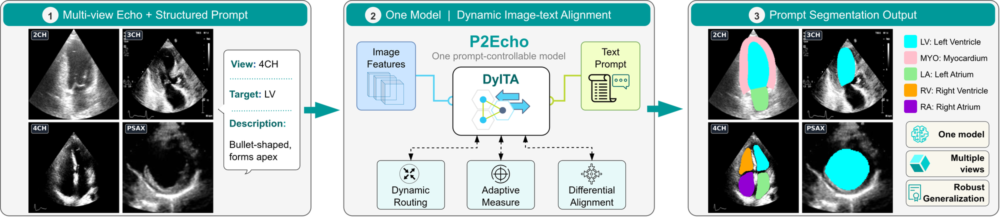

# Prompt2Echo (P2Echo): Text-Prompted Multi-View Echocardiography Segmentation with One Model

[](https://arxiv.org/abs/ARXIV_ID_PLACEHOLDER)
[](https://PROJECT_PAGE_PLACEHOLDER)

[](https://PROJECT_PAGE_PLACEHOLDER)

**P2Echo** segments cardiac structures (LV, MYO, LA, RV, RA) in 2CH, 3CH, 4CH and PSAX echocardiography with a
single network controlled by view-aware text prompts. Prompts are embedded by a frozen Qwen3-Embedding-0.6B
model, grounded in the image by a prompt decoder, and injected at every decoder stage through the
Dynamic Image-Text Alignment (DyITA) module. Each output map follows its prompt, so the same image can be queried
for any of the five structures.

| mDice (%) ↑ | 2CH | 3CH | 4CH | PSAX | HMC-QU | CardiacNet |
|---|---|---|---|---|---|---|
| nnUNet | 92.82 | 93.07 | 91.39 | 91.50 | 45.30 | 88.13 |
| SAM3 (fine-tuned) | 93.39 | 92.70 | 90.85 | 91.18 | 43.46 | 90.62 |
| EchoONE | 91.69 | 93.60 | 91.11 | 91.71 | 53.96 | 88.10 |
| **P2Echo** | **97.46** | **95.05** | **94.45** | **91.99** | **82.00** | **92.66** |

<sub>Internal test views (left) and held-out external datasets (right). P2Echo numbers are reproduced by the
released checkpoint with the commands below.</sub>



## Installation

```bash
git clone https://github.com/moeinheidari7829/P2Echo.git
cd P2Echo
conda create -n p2echo python=3.11 -y && conda activate p2echo
pip install -r requirements.txt
```

The Qwen3-Embedding-0.6B text encoder is downloaded from Hugging Face on first use.

## Data

We cannot redistribute the datasets. Please download them from their official sources:

| Dataset | Role | Link |
|---|---|---|
| CAMUS | train / test | [CREATIS CAMUS database](https://www.creatis.insa-lyon.fr/Challenge/camus/databases.html) |
| CardiacUDA | train / test | [GitHub repository](https://github.com/XiaoweiXu/CardiacUDA-dataset) |
| EchoCP | train / test | [GitHub repository](https://github.com/XiaoweiXu/EchoCP-An-Echocardiography-Dataset-in-Contrast-Transthoracic-Echocardiography-for-PFO-diagnosis) |
| EchoNet-Pediatric | train / test | [Project website](https://echonet.github.io/pediatric/) |
| SegRWMA | train / test | [GitHub repository](https://github.com/XiaoweiXu/Segment-level-Assessment-of-Regional-Wall-Motion-Abnormality-from-Echocardiography-Images) |
| CardiacNet | external | [Kaggle dataset page](https://www.kaggle.com/datasets/xiaoweixumedicalai/abnormcardiacechovideos) |
| HMC-QU | external | [Kaggle dataset page](https://www.kaggle.com/datasets/aysendegerli/hmcqu-dataset) |

Convert every annotated frame to a PNG image and a single-channel PNG label map with
`0 = background, 1 = LV, 2 = MYO, 3 = LA, 4 = RV, 5 = RA` (for HMC-QU the LV cavity is obtained by closing
and filling the myocardium contour, see the paper), and arrange them as

```
data/
├── Camus/{2CH,4CH}/{images,masks}/*.png
├── CardiacUDA/4CH/{images,masks}/*.png
├── EchoCP/4CH/...
├── EchoNet-Pediatric/{4CH,PSAX}/...
├── SegRWMA/{2CH,3CH,4CH}/...
├── CardiacNet/4CH/...
└── HMCQU/4CH/...
```

Then create a split file (80/10/10 per development dataset, external datasets held out):

```bash
python tools/make_splits.py --data_root data --output splits.json
```

The split file is a JSON with `train`, `val`, `test` and `external` lists of
`{"image_path", "mask_path", "view", "dataset"}` entries, with paths relative to `--data_root`.

## Pretrained weights

- ImageNet PVTv2-B2 (needed for training only):
  ```bash
  mkdir -p pretrained && wget -P pretrained https://github.com/whai362/PVT/releases/download/v2/pvt_v2_b2.pth
  ```
- P2Echo checkpoint: [Google Drive](https://drive.google.com/file/d/1wKF_MnWlMcpfYZTurb2wHOobENmhHQuj/view?usp=sharing). Place it at `checkpoints/p2echo.pth`
  (SHA-256 `2892bb52eb3011031217332a0614a87aae895e006850ec08187fcd95197fd16a`).

## Training

```bash
python train.py --splits splits.json --data_root data --output runs/p2echo
```

Default arguments reproduce the paper setting: 200 epochs, SGD (lr 0.01, momentum 0.9, weight decay 1e-4),
batch size 32, polynomial decay, BF16 mixed precision, Boundary-DoU loss with deep supervision. The checkpoint
with the best validation mDice is saved as `runs/p2echo/best.pth`. Training takes about two days on one H100.

## Evaluation

Internal test set (per view, Table III) and external datasets (Table IV):

```bash
python test.py --checkpoint checkpoints/p2echo.pth --splits splits.json --data_root data --split test
python test.py --checkpoint checkpoints/p2echo.pth --splits splits.json --data_root data --split external
```

Prompt intervention (Table VI):

```bash
python tools/prompt_intervention.py --checkpoint checkpoints/p2echo.pth --splits splits.json --data_root data
```

Parameters, MACs and latency (Table VII):

```bash
python tools/benchmark.py --checkpoint checkpoints/p2echo.pth
```

## Using the model

```python
import torch
from p2echo import P2Echo, TextEncoder
from p2echo.prompts import structure_prompt

device = "cuda"
text_encoder = TextEncoder().to(device)
model = P2Echo().to(device).eval()
model.load_state_dict(torch.load("checkpoints/p2echo.pth", map_location="cpu")["model"])

prompts = [structure_prompt("4CH", s) for s in ("LV", "LA")]
emb = text_encoder(prompts, device).unsqueeze(0)              # [1, 2, 1024]
image = ...                                                     # [1, 3, 256, 256], see p2echo/data.py
probs = torch.sigmoid(model(image, emb)[0])                   # [1, 2, 256, 256], one map per prompt
```

## Citation

```bibtex
@article{heidari2026p2echo,
  title   = {Prompt2Echo (P2Echo): Text-Prompted Multi-View Echocardiography Segmentation with One Model},
  author  = {Heidari, Moein and Kimbowa, Alvin and Tabatabaei, Mahdi and Bozorgpour, Afshin and
             Ghorbani Kolahi, Sina and Jiang, River and Chen, Wenjin and Foran, David J. and
             Grewal, Jasmine and Merhof, Dorit and Hacihaliloglu, Ilker},
  journal = {arXiv preprint arXiv:ARXIV_ID_PLACEHOLDER},
  year    = {2026}
}
```

## Acknowledgements

This code builds on [PVTv2](https://github.com/whai362/PVT), [CENet](https://github.com/xmindflow/CENet),
[Boundary DoU loss](https://github.com/sunfan-bvb/BoundaryDoULoss), [batchgenerators](https://github.com/MIC-DKFZ/batchgenerators)
and [Qwen3-Embedding](https://huggingface.co/Qwen/Qwen3-Embedding-0.6B).
